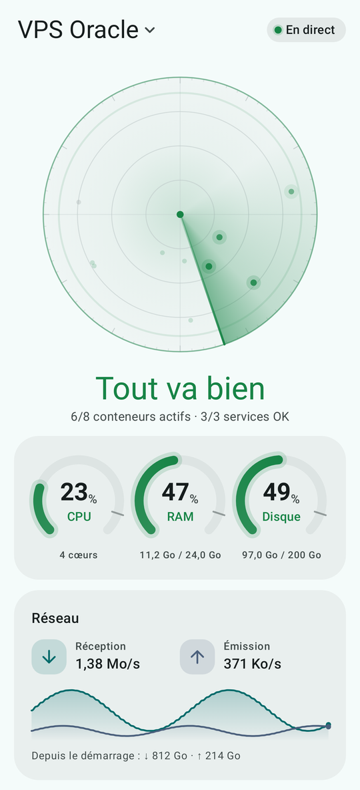
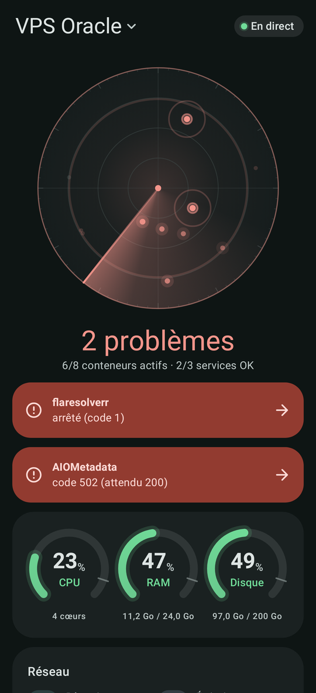
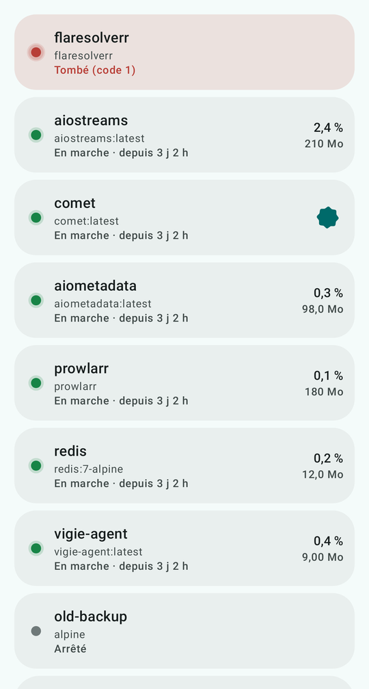
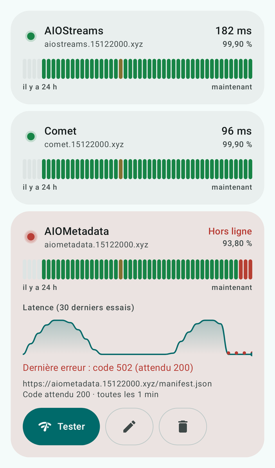

# Vigie

Surveille et pilote ton VPS depuis ton téléphone.

- **Agent** (`/agent`) : petit service Go (~12 Mo, ~10 Mo de RAM) qui lit les métriques de l'hôte, suit les conteneurs Docker, exécute des checks HTTP, garde 7 jours d'historique (SQLite) et envoie des alertes push (FCM).
- **Appli** (`/app`) : appli Android native Material You (Kotlin, Jetpack Compose).

Tout se déploie **sans SSH** : un `docker-compose` collé dans Dockhand, une ressource Pangolin, un QR code à scanner.

<p align="center">
  
  
  
  
</p>

---

## 1. L'image de l'agent

GitHub Actions construit l'image `ghcr.io/karelisio/vigie-agent` (amd64 + arm64) à chaque push :

| Tag | Quand |
| --- | --- |
| `latest` | branche `main` et chaque version `vX.Y.Z` |
| `X.Y.Z` | chaque version |
| `edge` | autres branches (tests) |

**Une seule fois, après le premier build** : GitHub › ton profil › *Packages* › `vigie-agent` › *Package settings* › *Change visibility* › **Public**. Sinon Dockhand ne pourra pas télécharger l'image sans identifiants.

## 2. Déployer l'agent dans Dockhand

1. Dockhand › **Stacks** › **Créer**, nom : `vigie`.
2. Colle le contenu de [`deploy/docker-compose.yml`](deploy/docker-compose.yml).
3. Vérifie ces lignes :
   - `VIGIE_PUBLIC_URL` : `https://vigie.15122000.xyz` (l'adresse que tu exposeras via Pangolin) ;
   - `VIGIE_CHECKS` : les URLs de tes addons Stremio (modifiables ensuite dans l'appli) ;
   - `VIGIE_TOKEN` : laisse vide, un token aléatoire est généré.
4. **Déployer**.

Le réseau `arr_backend` doit déjà exister (c'est celui de tes autres services). L'agent n'expose aucun port sur l'hôte : seul Pangolin y accède, via ce réseau.

Ce que monte le compose, et pourquoi :

| Montage | Usage |
| --- | --- |
| `/var/run/docker.sock` | liste, stats, logs, start/stop/restart des conteneurs (aucune autre commande Docker n'est exposée par l'API) |
| `/proc` et `/sys` en lecture seule | CPU, RAM, réseau, charge, uptime, température |
| `/` en lecture seule | occupation du disque |
| volume `vigie-data` | base SQLite, token |

Le conteneur tourne en lecture seule, sans aucune capability Linux, limité à 192 Mo de RAM et 0,5 CPU.

## 3. Exposer l'agent avec Pangolin

1. DNS : enregistrement `A` `vigie` → IP du VPS, **DNS only** (déjà fait).
2. Pangolin › **Resources** › **Add Resource** :
   - Type : **HTTP**, sous-domaine `vigie`, domaine `15122000.xyz` ;
   - Site : celui de ton VPS ;
   - Target : méthode `http`, hôte **`vigie-agent`**, port **`8080`**.
3. Onglet **Authentication** : l'appli ne peut pas passer par la page de connexion SSO. Au choix :
   - **simple** : désactive *Use Platform SSO* pour cette ressource (l'API reste protégée par le token) ;
   - **ou ciblé** : garde le SSO et ajoute dans **Rules** une règle *Path* `/api/*` → **Always Allow**, et une autre `/healthz` → **Always Allow**.
4. Test : `https://vigie.15122000.xyz/healthz` doit afficher `{"ok":true,…}`.

Les WebSockets (temps réel, logs en direct) passent par Pangolin sans réglage particulier.

## 4. Installer et connecter l'appli

Télécharge l'APK de la dernière version dans [Releases](https://github.com/Karelisio/Vigie/releases/latest) et installe-le. Les versions suivantes s'installent ensuite depuis l'appli elle-même.


1. Dockhand › conteneur **vigie-agent** › **Logs** : un QR code s'affiche au premier démarrage.
2. Appli Vigie › **Ajouter un serveur** › **Scanner le QR code**. L'URL et le token sont remplis automatiquement.
3. Pas de QR lisible ? Copie le **Lien** `vigie://connect?…` affiché sous le QR, ou saisis l'URL et le token à la main.

Le QR n'est affiché qu'au premier démarrage. Pour le revoir : ajoute `VIGIE_SHOW_QR: "true"` dans le compose, redéploie, puis retire-le. Si la visionneuse de logs a un fond clair : `VIGIE_QR_INVERT: "true"`.

## 5. Notifications push (Firebase)

Vigie réutilise ton projet Firebase existant.

**Côté appli** (pour la compilation) :
1. Console Firebase › ton projet › **Ajouter une appli** › Android › package `com.karelisio.vigie`.
2. Télécharge `google-services.json` et ajoute-le en secret GitHub (étape 6).

**Côté agent** (pour l'envoi) :
1. Console Firebase › ⚙ **Paramètres du projet** › **Comptes de service** › **Générer une nouvelle clé privée** → un fichier `.json`.
2. Encode-le en base64, **sur ton ordinateur** (n'utilise pas de site web : cette clé donne accès à ton projet) :
   - Windows (PowerShell) : `[Convert]::ToBase64String([IO.File]::ReadAllBytes("cle.json")) | Set-Clipboard`
   - macOS : `base64 -i cle.json | pbcopy`
   - Linux : `base64 -w0 cle.json`
3. Colle le résultat dans `FCM_SERVICE_ACCOUNT_B64` du compose dans Dockhand, puis redéploie.
4. Appli › Réglages › **Envoyer une notification de test**.

Alertes envoyées : conteneur tombé, redémarrages en boucle (3 en 10 min), healthcheck en échec, manque de mémoire (OOM), CPU/RAM/disque au-dessus du seuil pendant 5 min, check HTTP en échec 2 fois de suite, et retour à la normale. Une même alerte n'est pas renvoyée avant 30 min.

## 6. Secrets GitHub (compilation de l'APK)

Dépôt › **Settings** › **Secrets and variables** › **Actions** › **New repository secret** :

| Secret | Contenu |
| --- | --- |
| `KEYSTORE_BASE64` | ton keystore `.jks` encodé en base64 (même commande qu'à l'étape 5) |
| `KEYSTORE_PASSWORD` | mot de passe du keystore |
| `KEY_ALIAS` | alias de la clé |
| `KEY_PASSWORD` | mot de passe de la clé |
| `GOOGLE_SERVICES_JSON_BASE64` | `google-services.json` encodé en base64 |

Utilise **toujours le même keystore** : sinon Android refusera la mise à jour par-dessus l'appli installée.

Pas encore de keystore ? Sur un ordinateur avec Android Studio (ou un JDK) :

```
keytool -genkeypair -v -keystore vigie.jks -alias vigie -keyalg RSA -keysize 4096 -validity 36500
```

## 7. Publier une version

Au choix :
- GitHub › **Releases** › **Draft a new release** › *Choose a tag* › `v1.2.0` › **Publish** ;
- ou GitHub › **Actions** › **Release** › **Run workflow** › version `1.2.0` (le tag est créé automatiquement).

GitHub Actions :
- construit l'image de l'agent `X.Y.Z` + `latest` ;
- compile l'APK signé (`versionCode` = numéro d'exécution du workflow) ;
- publie la release avec l'APK et le changelog (section `## [X.Y.Z]` de [`CHANGELOG.md`](CHANGELOG.md), sinon la liste des commits).

L'appli vérifie la dernière release au lancement (au plus toutes les 6 h) et propose la mise à jour.

## L'appli en bref

- **Accueil** : radar animé (vert et lent quand tout va bien, rouge et plus rapide en cas de problème, écho pulsé sur le point en défaut), jauges CPU/RAM/disque, réseau en temps réel, historique 24 h / 7 jours.
- **Conteneurs** : recherche, filtres, glisser vers la droite pour redémarrer et vers la gauche pour arrêter ou démarrer (l'arrêt est confirmé), fiche détaillée avec graphiques, logs en direct avec recherche et niveaux colorés.
- **Services** : checks HTTP (préréglages AIOStreams, Comet, AIOMetadata), latence, barres de disponibilité sur 24 h, 7 ou 90 jours.
- **Widget** redimensionnable aux couleurs du système, **tuile** de réglages rapides, **mode hors ligne** avec l'heure de la dernière mise à jour.
- Plusieurs serveurs possibles (nom, URL, token), tokens chiffrés sur le téléphone (EncryptedSharedPreferences).
- Respecte le réglage système « Supprimer les animations ».

Captures d'écran : `./gradlew :app:recordRoborazziDebug` (rendu dans `app/build/outputs/roborazzi/`).

---

## Configuration de l'agent

| Variable | Défaut | Rôle |
| --- | --- | --- |
| `VIGIE_TOKEN` | généré | token d'accès (32 caractères minimum) |
| `VIGIE_PUBLIC_URL` | — | URL publique, intégrée au QR code |
| `VIGIE_SERVER_NAME` | nom d'hôte | nom affiché dans l'appli |
| `VIGIE_CHECKS` | — | checks HTTP ajoutés au démarrage : `Nom \| URL \| code \| mot-clé` |
| `VIGIE_ALERT_CPU` / `_RAM` / `_DISK` | `90` | seuils d'alerte en % |
| `VIGIE_ALERT_DURATION` | `5m` | durée de dépassement avant alerte CPU/RAM |
| `VIGIE_ALERT_COOLDOWN` | `30m` | délai minimum entre deux notifications identiques |
| `VIGIE_RESTART_LOOP_COUNT` / `_WINDOW` | `3` / `10m` | détection des redémarrages en boucle |
| `VIGIE_CHECK_FAILURES` | `2` | échecs consécutifs avant alerte |
| `VIGIE_IGNORE` | — | conteneurs à ne jamais signaler (aussi possible avec le label `vigie.ignore=true`) |
| `VIGIE_RATE_LIMIT` / `_BURST` | `10` / `60` | requêtes par seconde et rafale autorisées par IP |
| `VIGIE_SHOW_QR` / `VIGIE_QR_INVERT` | `false` | réafficher / inverser le QR code |
| `FCM_SERVICE_ACCOUNT_B64` | — | compte de service Firebase (base64) |
| `DOCKER_HOST` | `unix:///var/run/docker.sock` | accepte aussi `tcp://socket-proxy:2375` |

### Sécurité

- Toutes les routes (sauf `/healthz`) exigent `Authorization: Bearer <token>`, comparé à temps constant.
- Limitation de débit par IP ; 10 échecs d'authentification en 10 min → IP bloquée 15 min.
- Actions possibles : **start, stop, restart**, rien d'autre. L'agent refuse de s'arrêter lui-même.
- Chaque action est enregistrée dans un journal (date, IP, action, cible, résultat), consultable dans l'appli.
- Les variables d'environnement des conteneurs ne sont jamais exposées.

Pour aller plus loin, tu peux placer un [socket-proxy](https://github.com/linuxserver/docker-socket-proxy) entre l'agent et Docker (`CONTAINERS=1`, `EVENTS=1`, `INFO=1`, `ALLOW_START=1`, `ALLOW_STOP=1`, `ALLOW_RESTARTS=1`, `POST=0`) et pointer `DOCKER_HOST` dessus.

L'API est décrite dans [`docs/API.md`](docs/API.md).
